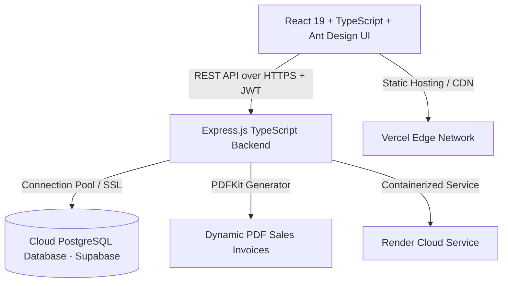

# Mini ERP + CRM Operations Portal

> **Full Stack Developer Case Study Submission**  
> A complete, role-based ERP & CRM system built for wholesale and distribution companies.  
> Handles Customer Relationship Management, Product Catalog & Inventory Tracking, Atomic Stock Movements, and Sales Challans with Automated PDF Invoicing.

---

## 🌐 Live Deployment Links

- **Live Frontend (Vercel)**: [https://mini-erp-crm-portal-theta.vercel.app](https://mini-erp-crm-portal-theta.vercel.app)
- **Live Backend REST API (Render)**: [https://mini-erp-crm-portal-za5a.onrender.com](https://mini-erp-crm-portal-za5a.onrender.com)
- **GitHub Repository**: [https://github.com/Abhi200550/mini-erp-crm-portal](https://github.com/Abhi200550/mini-erp-crm-portal)
- **Postman API Collection**: Included in repository at [`postman_collection.json`](./postman_collection.json)

---

## 🔑 Test Login Credentials (Role-Based Access)

Use any of the one-click demo login buttons on the web portal, or enter credentials manually:

| Role | Email Address | Password | Permissions & Access Scope |
| :--- | :--- | :--- | :--- |
| 👑 **Admin** | `admin@verveerp.com` | `password123` | Full access across all CRM, Inventory, Sales Challans, and System Settings |
| 💼 **Sales** | `sales@verveerp.com` | `password123` | Customer CRM, Create & View Sales Challans, Add Follow-up Notes |
| 📦 **Warehouse** | `warehouse@verveerp.com` | `password123` | Product Catalog, Stock In/Out Adjustments, Audit Logs, Confirm Challan Dispatches |
| 💳 **Accounts** | `accounts@verveerp.com` | `password123` | Customer Records, Challan Invoices, PDF Invoice Generation & Financial View |

---

## 🏗️ Architecture & Tech Stack



### **Tech Stack Overview**
- **Frontend**: React 19, TypeScript, Ant Design v5, React Router 7, Axios, Moment.js, Vite
- **Backend**: Node.js 20, TypeScript, Express.js REST API, Zod Validation, JWT Authentication, Bcrypt, PDFKit
- **Database**: Cloud PostgreSQL (Supabase) with ACID transactions, Row-Level Security, and Indexes
- **DevOps**: Docker, Docker Compose, GitHub Actions, Vercel, Render

---

## 🚀 Core Features & Business Logic

### 1. Customer CRM Module
- **Customer Management**: Full lifecycle management with Retail, Wholesale, and Distributor customer types.
- **Status Pipeline**: Categorize leads into `Lead`, `Active`, and `Inactive`.
- **Search & Filters**: Multi-field search by customer name, mobile, business name, and customer type.
- **Follow-up Timeline**: Interactive CRM notes timeline with timestamps and author signatures.
- **Customer Details Drawer**: Slide-out profile view with GST numbers, addresses, and full contact information.

### 2. Product & Inventory Module
- **SKU & Catalog Tracking**: Track products with unique SKU codes, categories, unit prices, and warehouse locations.
- **Real-Time Stock Alerts**: Dynamic badges highlighting low stock items (`current_stock <= min_stock_alert`).
- **Inventory Adjustments**: Record manual stock additions (Stock IN) or damage/returns (Stock OUT) with mandatory reasons.
- **Immutable Audit Log**: Real-time stock movement ledger logging product, quantity change, movement type, reason, and timestamps.

### 3. Sales Challan & Invoicing Module
- **Multi-Product Selection**: Build delivery challans with multiple line items, real-time quantity validation, and pricing summaries.
- **Atomic Stock Deduction**: Confirming a challan executes within an ACID database transaction:
  1. Validates inventory levels (`current_stock >= requested_qty`).
  2. Deducts product stock atomically.
  3. Inserts immutable `OUT` stock movement records.
  4. Marks challan as `Confirmed`.
- **Prevent Negative Inventory**: Built-in guard rails return validation errors if inventory is insufficient.
- **Historical Snapshot Preservation**: Freezes product name, SKU, and unit price at time of sale so catalog price changes do not alter past invoices.
- **Automated PDF Export**: Server-rendered A4 delivery challan invoices formatted with GST details, item breakdown, and grand totals.

---

## 💻 Local Setup Instructions

### Prerequisites
- Node.js (v18 or higher)
- npm or yarn
- PostgreSQL (or Docker)

### 1. Clone the Repository
```bash
git clone https://github.com/Abhi200550/mini-erp-crm-portal.git
cd mini-erp-crm-portal
```

### 2. Run with Docker Compose (Fastest Method)
```bash
docker-compose up --build
```
- Backend will be available at: `http://localhost:5000`
- PostgreSQL database initialized with sample seed data on port `5432`.

### 3. Run Manually (Local Development)

#### Backend Setup:
```bash
cd server
npm install
npm run build
npm run dev
```

#### Frontend Setup:
```bash
cd ../client
npm install
npm run dev
```
Open `http://localhost:5173` in your browser.

---

## 📡 REST API Endpoint Documentation

| Method | Endpoint | Access Role | Description |
| :--- | :--- | :--- | :--- |
| `GET` | `/api/health` | Public | Health check and server status |
| `POST` | `/api/auth/login` | Public | Authenticate user and return JWT bearer token |
| `GET` | `/api/auth/me` | Authenticated | Retrieve authenticated user profile |
| `GET` | `/api/customers` | Authenticated | List, filter, search, and paginate customers |
| `GET` | `/api/customers/:id` | Authenticated | Get detailed customer record |
| `POST` | `/api/customers` | Admin, Sales, Accounts | Create a new customer |
| `PUT` | `/api/customers/:id` | Admin, Sales, Accounts | Update existing customer details |
| `POST` | `/api/customers/:id/notes`| Admin, Sales, Accounts | Append follow-up note to customer profile |
| `GET` | `/api/products` | Authenticated | List products with inventory & low stock filters |
| `POST` | `/api/products` | Admin, Warehouse | Add new product to catalog |
| `PUT` | `/api/products/:id` | Admin, Warehouse | Update product details |
| `POST` | `/api/stock-movements` | Admin, Warehouse | Adjust stock (IN/OUT) with audit trail |
| `GET` | `/api/stock-movements` | Authenticated | View immutable stock movement audit ledger |
| `GET` | `/api/challans` | Authenticated | List all sales challans |
| `GET` | `/api/challans/:id` | Authenticated | Get challan details and snapshot items |
| `POST` | `/api/challans` | Admin, Sales, Accounts | Create new sales challan (Draft or Confirmed) |
| `POST` | `/api/challans/:id/confirm` | Admin, Sales, Warehouse, Accounts | Confirm challan & atomically deduct stock |
| `POST` | `/api/challans/:id/cancel` | Admin, Sales | Cancel pending draft challan |
| `GET` | `/api/challans/:id/pdf` | Authenticated | Generate and stream A4 PDF invoice |

---

## 🛡️ Database Schema (PostgreSQL)

```sql
-- Core Tables Created:
- users (id, email, password_hash, role, created_at)
- customers (id, name, mobile, email, business_name, gst_number, customer_type, status, address, follow_up_date, notes)
- products (id, name, sku, category, unit_price, current_stock, min_stock_alert, location)
- stock_movements (id, product_id, quantity, movement_type, reason, created_by, created_at)
- sales_challans (id, challan_number, customer_id, status, total_amount, created_by, created_at)
- challan_items (id, challan_id, product_id, product_name_snapshot, sku_snapshot, unit_price_snapshot, quantity, line_total)
```

---

## 📌 Assumptions & Known Considerations
1. **Demo Credentials**: Pre-configured demo accounts are provided for instant evaluation without manual user registration.
2. **Currency**: Indian Rupee (₹ - INR) formatting is applied by default across pricing, challans, and PDF invoices.
3. **Draft vs Confirmed**: Draft challans do not affect inventory; stock deduction is triggered upon confirmation.
4. **PDF Generation**: Handled dynamically on the backend using `PDFKit` and streamed directly to the browser.
